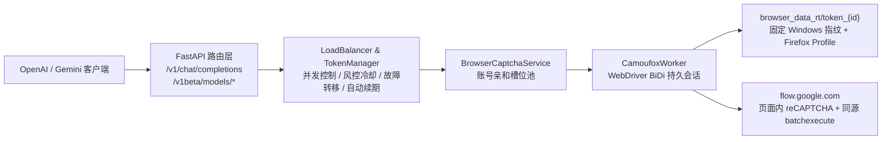

# flow2api-Camoufox

<div align="center">

[](LICENSE)
[](https://www.python.org/)
[](https://fastapi.tiangolo.com/)
[](https://github.com/daijro/camoufox)

**基于 Camoufox + WebDriver BiDi 原生浏览器管线的 Google Flow OpenAI / Gemini 兼容 API 服务**

</div>

---

## ✨ 核心特性

- 🦊 **Camoufox + WebDriver BiDi 原生引擎**：移植自 `AIStudio2API` 的反检测浏览器架构，内置 C++ 级 Windows 10/11 硬件指纹、WebGL 显卡特征、字体子集与音频上下文锁定，结合页面内同源 `batchexecute` RPC（`ogiZ0b` / `YhhmEf` / `fZytfe` / `p0UkFb`）与真实 `reCAPTCHA Enterprise` 打码，避免打码端与请求端 TLS/Cookie/Session 割裂。
- 🛡️ **多账号风控冷却、自动故障转移与防重复提交**：`LoadBalancer` 与 `GenerationHandler` 支持在提交前遇到 `PUBLIC_ERROR_UNUSUAL_ACTIVITY` / `too much traffic` / `429` 时自动冷却当前账号（默认 180 秒）并无感切换下一个可用账号；检测到登录态失效时立即冒泡并自动禁用对应 Token；对生成类 RPC 超时严格标记 `submission_uncertain` 防止重复扣费。
- 🖥️ **WebSocket LiveView 远程登录向导**：管理后台内置无头浏览器实时画面流（Canvas 帧流 + 键鼠转发），无需桌面环境或 Xvfb，直接在网页内完成 Google 账号登录并自动导出完整 Cookie 与持久化 Profile。
- 🔄 **全自动无感 Cookie 续期**：服务启动时自动唤醒常驻 Camoufox 槽位，后台定时通过账号绑定的真实浏览器实例续期 `__Secure-1PSIDTS` / `SIDCC` / `OSID` 并同步写回 SQLite 与 `storage-state.json`。
- 🪶 **极致精简与高性能工程化**：彻底移除旧版 `nodriver` / `playwright` 有头打码、Chrome 扩展目录（`extension/`）及 10 家第三方付费打码通道；内置持久化 SQLite 连接池、HTTP/TLS 连接复用与非阻塞异步媒体缓存。
- 🧩 **双协议兼容**：同时支持 OpenAI `/v1/chat/completions`（流式/非流式）与 Gemini 官方 `/v1beta/models/{model}:generateContent` / `:streamGenerateContent`（及 `/models/...`）接口。
- 📊 **全新管理控制台**：重构登录页、管理后台（`/manage`）与在线测试台（`/test`），支持多 Token 轮询、并发控制、实时积分查询、代理池配置及中英文无缝切换。

---

## 🏗️ 架构概览



---

## 🚀 快速开始

### 前置要求

- Python 3.10+（推荐 3.11–3.13）
- 无需预装 Chrome / Playwright / Xvfb：首次启动或开启浏览器登录时，服务会自动检测并按需下载对应平台（macOS `arm64`/`x86_64`、Linux `x86_64`/`arm64`、Windows `x86_64`）的 Camoufox 二进制包至 `.runtime/camoufox/`。

### 本地部署

```bash
# 1. 克隆仓库
git clone https://github.com/jianli9158/flow2api-Camoufox.git
cd flow2api-Camoufox

# 2. 创建并激活虚拟环境
python3 -m venv .venv
source .venv/bin/activate  # Windows: .venv\Scripts\activate

# 3. 安装依赖
pip install -r requirements.txt

# 4. 启动服务（首次启动会自动从 config/setting_example.toml 生成 config/setting.toml 与数据库）
python main.py
```

### Docker 部署

```bash
git clone https://github.com/jianli9158/flow2api-Camoufox.git
cd flow2api-Camoufox
cp -n config/setting_example.toml config/setting.toml
docker compose up -d --build
```

> 容器镜像已内置无头 Camoufox 所需的 GTK3 / X11 / 音频共享库，并挂载 `./browser_data_rt` 与 `./data` 持久化账号指纹及 SQLite 数据。默认通过 `FLOW2API_SERVER_PORT=8000` 监听容器内 `8000` 端口。

### 首次访问与添加账号

1. 打开管理后台：**`http://localhost:8000`**（若 `config/setting.toml` 修改了端口则以实际端口为准），默认账号密码为 `admin` / `admin`，首次登录后请在「系统配置」中修改密码与 API Key。
2. 在 **Token 列表** 点击 **「浏览器登录」**：
   - 弹窗内会直接显示无头 Camoufox 浏览器的实时画面，点击画面即可输入 Google 账号与密码完成登录。
   - 当浏览器跳转到 `https://flow.google.com/projects` 后，系统会自动提取完整 Google/Flow Cookies、绑定专属 Windows 指纹并落盘到 `browser_data_rt/token_<id>/`。
   - 也可以点击 **「新增 Token」** 直接粘贴 JSON Cookie 数组或 `Header String`。

---

## 📈 监控与管理接口

- `GET /health`：公开健康检查，返回服务存活状态、活跃 Token 数、即将过期 Token 数、已过期 Token 数、429 禁用数等摘要。
- `GET /metrics`：Prometheus 指标接口。
- `GET /api/tokens`：管理接口，返回 Token 状态、积分余额、订阅等级（Paygate Tier）、上次自动刷新时间与结果。
- `GET /test`：内置模型在线测试台，支持分类选择图片/视频模型、上传参考图、实时查看流式进度与生成结果预览。

---

## 📋 支持的模型

### 1. 图片生成

当前 `/v1/models` 与 Gemini `/models` 公开 **Nano Banana 2.1**（`BELUGA`）、**Nano Banana 2 Lite**（`HARBOR_SEAL`）与 **Nano Banana Pro**（`GEM_PIX_2`）三个图片系列，共 **45 个**比例与分辨率变体，并支持通过简写别名 + `generationConfig.imageConfig` 动态解析：

| 图片系列 | 公开模型 ID 前缀 | 简写别名（支持 `aspectRatio` / `imageSize`） | 上游模型标识 |
|---|---|---|---|
| **Nano Banana 2.1** | `gemini-3.1-flash-image-*` | `gemini-3.1-flash-image`、`nano-banana-2.1`、`nano-banana-2` | `BELUGA` |
| **Nano Banana 2 Lite** | `gemini-3.1-flash-lite-image-*` | `gemini-3.1-flash-lite-image`、`nano-banana-2-lite` | `HARBOR_SEAL` |
| **Nano Banana Pro** | `gemini-3.0-pro-image-*` | `gemini-3.0-pro-image`、`nano-banana-pro` | `GEM_PIX_2` |

每个系列均包含以下 15 个比例与分辨率后缀（以下以 `gemini-3.1-flash-image-*` 为例）：

| 当前公开名称 | 分辨率 | 比例 |
|---|---:|---:|
| `gemini-3.1-flash-image-landscape` | 默认 | 横屏 16:9 |
| `gemini-3.1-flash-image-portrait` | 默认 | 竖屏 9:16 |
| `gemini-3.1-flash-image-square` | 默认 | 方图 1:1 |
| `gemini-3.1-flash-image-four-three` | 默认 | 横屏 4:3 |
| `gemini-3.1-flash-image-three-four` | 默认 | 竖屏 3:4 |
| `gemini-3.1-flash-image-landscape-2k` | 2K | 横屏 16:9 |
| `gemini-3.1-flash-image-portrait-2k` | 2K | 竖屏 9:16 |
| `gemini-3.1-flash-image-square-2k` | 2K | 方图 1:1 |
| `gemini-3.1-flash-image-four-three-2k` | 2K | 横屏 4:3 |
| `gemini-3.1-flash-image-three-four-2k` | 2K | 竖屏 3:4 |
| `gemini-3.1-flash-image-landscape-4k` | 4K | 横屏 16:9 |
| `gemini-3.1-flash-image-portrait-4k` | 4K | 竖屏 9:16 |
| `gemini-3.1-flash-image-square-4k` | 4K | 方图 1:1 |
| `gemini-3.1-flash-image-four-three-4k` | 4K | 横屏 4:3 |
| `gemini-3.1-flash-image-three-four-4k` | 4K | 竖屏 3:4 |

Nano Banana 2 Lite 与 Nano Banana Pro 分别使用 `gemini-3.1-flash-lite-image-*` 和 `gemini-3.0-pro-image-*`，比例及分辨率后缀与上表完全一致（例如 `gemini-3.1-flash-lite-image-landscape`、`gemini-3.0-pro-image-portrait-2k`）。

### 2. 视频生成

| 当前公开名称 | 上游模型族 | 能力 |
|---|---|---|
| `veo-3.1-lite` / `veo-3.1-fast` / `veo-3.1-quality` / `omni-1.1-flash` | 默认别名 | 8 秒横屏文生视频 |
| `veo-3.1-lite-{4,6,8}s-{landscape,portrait}` | Veo 3.1 - Lite | 文生视频 |
| `veo-3.1-fast-{4,6,8}s-{landscape,portrait}` | Veo 3.1 - Fast | 文生视频 |
| `veo-3.1-quality-{4,6,8}s-{landscape,portrait}` | Veo 3.1 - Quality | 文生视频 |
| `omni-1.1-flash-{4,6,8,10}s-{landscape,portrait}` | Omni 1.1 Flash (`abra`) | 文生 / 参考图视频 |
| `veo-3.1-{lite,fast,quality}-i2v-{4,6}s-{landscape,portrait}` | Veo 3.1 | 首帧 / 首尾帧视频 |
| `veo-3.1-{lite,fast}-r2v-8s-{landscape,portrait}` | Veo 3.1 | 多参考图视频（最多 3 张） |
| `veo-3.1-{lite,fast,quality}-extend-8s-{landscape,portrait}` | Veo 3.1 | 视频续写 |

> 同时向后兼容全部旧版下划线模型名（如 `veo_3_1_t2v_fast_landscape`、`veo_3_1_i2v_s_fast_fl`、`veo_3_1_r2v_fast_landscape` 及 `*_1080p` / `*_4k` 视频超分模型）。

---

## 📡 API 调用示例

### 1. OpenAI 兼容格式 — 文生图

```bash
curl -X POST "http://localhost:8000/v1/chat/completions" \
  -H "Authorization: Bearer han1234" \
  -H "Content-Type: application/json" \
  -d '{
    "model": "gemini-3.1-flash-image-landscape",
    "messages": [
      {
        "role": "user",
        "content": "一只可爱的猫咪在花园里玩耍，自然晨光"
      }
    ],
    "stream": true
  }'
```

### 2. OpenAI 兼容格式 — 图生图

```bash
curl -X POST "http://localhost:8000/v1/chat/completions" \
  -H "Authorization: Bearer han1234" \
  -H "Content-Type: application/json" \
  -d '{
    "model": "gemini-3.1-flash-image-landscape",
    "messages": [
      {
        "role": "user",
        "content": [
          { "type": "text", "text": "将这张图片转换为吉卜力水彩画风格" },
          {
            "type": "image_url",
            "image_url": { "url": "data:image/jpeg;base64,<base64_encoded_image>" }
          }
        ]
      }
    ],
    "stream": true
  }'
```

### 3. OpenAI 兼容格式 — 文生视频

```bash
curl -X POST "http://localhost:8000/v1/chat/completions" \
  -H "Authorization: Bearer han1234" \
  -H "Content-Type: application/json" \
  -d '{
    "model": "veo-3.1-fast-8s-landscape",
    "messages": [
      {
        "role": "user",
        "content": "一只小猫在草地上追逐蝴蝶，电影级景深"
      }
    ],
    "stream": true
  }'
```

### 4. Gemini 官方 `generateContent` 格式

```bash
curl -X POST "http://localhost:8000/models/gemini-3.1-flash-image:generateContent" \
  -H "x-goog-api-key: han1234" \
  -H "Content-Type: application/json" \
  -d '{
    "contents": [
      {
        "role": "user",
        "parts": [
          { "text": "一颗放在木桌上的红苹果，棚拍光线，极简背景" }
        ]
      }
    ],
    "generationConfig": {
      "responseModalities": ["IMAGE"],
      "imageConfig": {
        "aspectRatio": "1:1",
        "imageSize": "1K"
      }
    }
  }'
```

---

## 📄 许可证

本项目采用 [MIT 许可证](LICENSE)。
