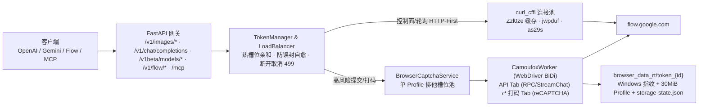

# Flow2API

**基于 Camoufox + WebDriver BiDi 原生浏览器管线的 Google Flow OpenAI / Gemini / Flow 原生兼容网关**

> 本项目基于开源项目 **[TheSmallHanCat/flow2api](https://github.com/TheSmallHanCat/flow2api)** 深度优化升级，重构了浏览器运行时（Camoufox + WebDriver BiDi 双 Tab 隔离）、防风控/热槽位调度、标准 OpenAI & Gemini/AI Studio 参数化 API、多 API Key 权限隔离、Flow 原生特性接口（`/v1/flow/*`）及内置 MCP 服务端。

Flow2API 通过隔离的 Camoufox（反检测 Firefox）浏览器会话与 WebDriver BiDi 协议直接驱动 `flow.google.com` 页面内原生交互与同源 RPC，将 Google Flow 的图像生成、视频生成（文生 / 图生 / 多图 / 续写 / 高清放大）、TTS 语音合成、持久化角色库、以及多轮 Creation Agent 统一封装为标准 OpenAI、Gemini / AI Studio、`/v1/flow/*` REST/SSE 与 `/mcp` 接口。
---

## 核心能力

- **Camoufox + WebDriver BiDi 双 Tab 隔离与分层执行管线**：模块化浏览器运行时（`camoufox_bidi.py`、`camoufox_fingerprint.py`、`bidi_transport.py`、`camoufox_profile.py`、`camoufox_login.py`）为每个账号锁定持久化 Windows 10/11 指纹（`camoufox-fingerprint.json`）、WebGL/字体子集与独立 Firefox Profile（`browser_data_rt/token_<id>/`）：
  - **同进程双 Tab 隔离与并发排队**：同一 Camoufox 进程内分离 **API Tab**（常驻 `flow.google.com`，专责 `WIZ_global_data`、同源 `batchexecute` RPC 与 `StreamChat`）与 **打码 Tab**（专责人类轨迹预热与 `grecaptcha.enterprise.execute`），共享同一份 Cookie / TLS / 代理而互不污染页面缓存；同账号并发请求在槽位条件变量上排队共享而非 502 冲突，遇 `PUBLIC_ERROR_UNUSUAL_ACTIVITY` 自动隔离清理 `_GRECAPTCHA` 并重建打码 Tab；子进程启用独立进程组回收防止僵尸残留，空闲裁剪结合 SQLite WAL 瘦身与临时目录回收。
  - **控制面分层路由与流式缓存**：只读查询与视频状态轮询 RPC（`Zzl0ze` 20s 缓存与单飞合并、`jwpduf`、`as29s`、`nzlxg`、`wDg3C`、Agent 会话、用户/项目设置等）优先走按账号/代理池化复用的 `curl_cffi` HTTP 控制面（单次 RPC 绑定固定代理、CAS 原子回写旋转 Cookie、遇风控自动回退浏览器），大媒体拉取与本地缓存统一流式分片写 `.part` 原子落盘。
- **三协议标准 API 兼容**：
  - **OpenAI 标准接口**：`GET /v1/models`、`POST /v1/images/generations`、`POST /v1/images/edits`、`POST /v1/chat/completions`（流式 SSE 进度 + 非流式），仅公开 **10 个标准基础模型**，通过参数控制比例/清晰度/时长（图像默认 `16:9` + `2K`，`n > 1` 并发生成）。
  - **Gemini / AI Studio 标准接口**：`GET /v1beta/models`、`GET /v1beta/models/{model}`、`POST /v1beta/models/{model}:generateContent`、`:streamGenerateContent`、`:predict`（及 `/models/...` 路径，兼容 `imagen-3*` 别名与 `sampleCount > 1` 并发生成），直接通过 `generationConfig.imageConfig` / `videoConfig` / `parameters` 控制比例、清晰度与时长。
  - **Flow 原生特征接口 (`/v1/flow/*`) 与内置 MCP (`/mcp`)**：项目管理、资产上传/解析、TTS 语音生成与试听缓存（`json`/`wav`/`pcm`）、角色 CRUD 与两段式自动建角、参考生视频 / 首尾帧生视频 / 多段串联、Creation Agent 多轮对话与费用确认（SSE / JSON）、用户与项目设置、Streamable HTTP MCP；全链路统一接入账号原子用量/成功/错误记账。
- **多 API Key 与按 Key 模型权限隔离**：保留主密钥默认公开全部模型，同时可在管理控制台（系统配置 → 安全配置）或 `/api/admin/apikeys` 创建多个受管子 API Key，按 Key 精确或通配符指定可见与可调用的模型集合，在 OpenAI / Gemini / Flow（含 4s/6s Veo 变体）/ MCP 全协议生效。
- **多账号调度、安全加固与自愈能力**：
  - `LoadBalancer` 支持热槽位亲和调度（`prefer_warm_browser`）、预占式并发防惊群、按模型族精细冷却（如仅冷却配额耗尽的 `image:GEM_PIX_2` 而不影响 `BELUGA` / `Veo`）、等级成本感知路由（廉价生图优先 Free/Pro，保留 Ultra 给 4K/高阶任务），并通过 `fcntl.flock` / `msvcrt` 内核级目录锁（`.flow2api-profile.lock`）实现跨进程 Profile 排他占用。
  - 基于结构化错误分类（`src/core/flow_errors.py`），严格区分内容安全（`400`）、权限/等级不足（`403`）、限流/配额（`429`，解析 `Retry-After` / `quotaResetTimeStamp` 并自动解禁）、Google `/about` 二次身份核验（`identity_recheck_required`）与付费视频提交后响应超时防重复扣费（返回 `charged=maybe` / `next_action=reconcile`）；支持 SSE 客户端断开即时取消上游、启动自动恢复孤儿任务与定时清理历史任务。
  - **边界安全防护**：出站下载逐跳禁用自动重定向并校验 SSRF 与流式体积上限（图片 50MB / 视频拼接 300MB）；二进制/非法编码入参安全返回 `422`/`400` 避免 500 崩溃；SQL 更新列白名单校验；完整适配 `X-Forwarded-Host` / `X-Forwarded-Proto` 与 `[server].path_prefix` 反代部署。
- **LiveView 网页远程登录向导**：管理后台内置 WebSocket 实时画面流（反代 Origin 适配、WS 在线自动抑制重复截图轮询）与键鼠转发，无需安装桌面环境或 Xvfb，在浏览器控制台即可完成 Google 账号登录并自动落盘完整凭证与指纹档案。
- **零外部 CDN 的重构控制台**：登录页（`/login`）、管理控制台（`/manage`）与工作台（`/test`）共用本地设计系统 `static/console.css`，通过 `GET /api/admin/bootstrap` 单请求完成首屏与配置聚合初始化，移除内联字符串拼接事件防范 XSS；支持浅色/深色主题切换、中英双语（`zh-CN` / `en`）、AI Studio 风格参数面板、Camoufox 槽位池实时监控、Score 检测、自动刷新请求日志以及 Creation Agent / 30 种预设音色试听与角色交互测试。
---

## 系统架构



---

## 快速开始

### 环境要求

- **Python**：3.10+（推荐 3.11–3.13）
- **浏览器运行时**：无需手动安装 Chrome 或 Playwright；首次启动服务或打开浏览器登录时，`src/services/camoufox_fingerprint.py` 会按宿主机架构（macOS `arm64`/`x86_64`、Linux `x86_64`/`arm64`、Windows `x86_64`）加锁自动下载并校验解压 Camoufox 至 `./runtime/camoufox/`（或复用本地 `CAMOUFOX_PATH`）。

### 本地源码部署

```bash
# 1. 克隆仓库
git clone https://github.com/jianli9158/flow2api-Camoufox.git
cd flow2api-Camoufox

# 2. 创建虚拟环境并安装依赖
python3 -m venv .venv
source .venv/bin/activate  # Windows: .venv\Scripts\activate
pip install -r requirements.txt

# 3. 启动服务（首次启动会自动从 config/setting_example.toml 生成 config/setting.toml 与 data/flow.db）
python main.py
```

默认监听 `http://0.0.0.0:8000`（可在 `config/setting.toml` 中调整 `[server].port`）。

### Docker Compose 部署

仓库提供三种 Compose 编排文件以适配不同部署环境：

1. **标准无头部署（推荐，`docker-compose.yml`）**
   ```bash
   cp -n config/setting_example.toml config/setting.toml
   docker compose up -d --build
   ```
   容器内置 GTK3 / X11 / 音频共享库支持无头 Camoufox，启用 `init: true` 与 `shm_size: "2gb"`，持久化挂载 `./data`、`./tmp`、`./browser_data_rt`、`./runtime` 与 `./config/setting.toml`，宿主机映射端口 **`38000:8000`**（访问 `http://localhost:38000`）。

2. **搭配 WARP 代理容器部署（`docker-compose.proxy.yml`）**
   ```bash
   cp -n config/setting_example.toml config/setting.toml
   docker compose -f docker-compose.proxy.yml up -d --build
   ```
   同时拉起 `caomingjun/warp` 容器（状态卷独立挂载至 `./data/warp`），并将 SOCKS5 入口安全绑定至本机 **`127.0.0.1:31080:1080`**。

3. **Xvfb 有头环境部署（`docker-compose.headed.yml`）**
   ```bash
   docker compose -f docker-compose.headed.yml up -d --build
   ```
   使用 `Dockerfile.headed` 启动虚拟显示 `DISPLAY=:99`（`1440x900x24`），端口映射 **`8000:8000`**。

### 首次登录与账号接入

1. 访问控制台 `http://localhost:8000`（Docker 标准部署为 `http://localhost:38000`），使用默认管理员凭证 `admin` / `admin` 登录，随后在「系统配置 -> 安全配置」修改管理员密码与 API Key。
2. 在 **Token 管理** 点击 **「浏览器登录」**：
   - 可选择 `auto`（本地弹窗 + 网页 LiveView）、`window`（本地可见窗口）或 `liveview`（纯无头网页远程画面，适合服务器与 Docker）。
   - 登录 Google 账号并跳转至 `https://flow.google.com/projects` 后，系统自动保存 Cookie、Windows 指纹、StorageState 及初始项目 UUID。
   - 如需通过浏览器扩展同步或手动导入，可使用「新增」或「导入」提交 JSON Cookie 导出或 `Cookie` 请求头字符串，或使用「系统配置 -> 插件连接配置」对接 Token Updater。

---

## 模型目录与标准参数规则

服务在 `/v1/models` 与 `/v1beta/models` 仅公开 **10 个标准基础模型**（**3 个图像模型 + 7 个视频模型**），不再刷屏展示上百个比例/分辨率后缀变体；所有画面比例、清晰度、时长均按 Google AI Studio / OpenAI 标准方式通过请求参数动态控制（旧版带后缀模型名仍在内部完整兼容，无破坏性变更）。

### 1. 图像生成（3 个标准模型 · 默认 `16:9` + `2K`）

| 标准模型 ID | 兼容别名 | 上游引擎 | 支持参数与默认值 |
|---|---|---|---|
| `gemini-3.1-flash-image` | `gemini-3.1-flash-image-preview`、`nano-banana-2.1`、`nano-banana-2`、`imagen-3.0-fast-generate-001` | `BELUGA` | `aspectRatio`: `16:9`（默认）、`9:16`、`1:1`、`4:3`、`3:4`<br>`imageSize`: `2K`（默认）、`1K`、`4K` |
| `gemini-3.1-flash-lite-image` | `gemini-3.1-flash-lite-image-preview`、`nano-banana-2-lite` | `HARBOR_SEAL` | 同上（默认 `16:9` + `2K`） |
| `gemini-3.0-pro-image` | `gemini-3-pro-image`、`gemini-3-pro-image-preview`、`nano-banana-pro`、`imagen-3.0-generate-002`、`imagen-3.0-generate-001`、`imagen-3` | `GEM_PIX_2` | 同上（默认 `16:9` + `2K`） |

> - 不传任何参数时默认生成 **16:9 横屏 2K** 图片；图生图未显式传 `aspectRatio` 时自动跟随参考图比例。
> - `aspectRatio` 还支持任意 `W:H`（如 `3:2`、`21:9`）或 OpenAI `size`（如 `1024x1024`、`1792x1024`），自动匹配最接近的 Flow 原生比例；显式传 `imageSize: "1K"` 或 `quality: "standard"` 可回落到 1K 基础图（Free 账号可用），传 `imageSize: "4K"` 或 `quality: "hd"` 可升至 4K（Ultra 账号）。

### 2. 视频生成（7 个标准模型 · 默认 `16:9` + `8s` + `720p`）

| 标准模型 ID | 模式 | 支持参数 |
|---|---|---|
| `veo-3.1-lite` | 文生视频 (T2V) | `aspectRatio`: `16:9` / `9:16`；`durationSeconds`: `4` / `6` / `8`；`resolution`: `720p` / `1080p` / `4K` |
| `veo-3.1-lite-i2v` | 图生视频 (首帧/首尾帧 1–2 图) | `aspectRatio`: `16:9` / `9:16`；`durationSeconds`: `4` / `6` / `8`；`resolution`: `720p` / `1080p` / `4K` |
| `veo-3.1-lite-r2v` | 多图参考视频 (1–3 图) | `aspectRatio`: `16:9` / `9:16`；`durationSeconds`: `8`；`resolution`: `720p` / `1080p` / `4K` |
| `veo-3.1-lite-extend` | 视频续写 (`extend://<mediaId>`) | `aspectRatio`: `16:9` / `9:16`；`resolution`: `720p` / `1080p` / `4K` |
| `omni-1.2-flash` | 文生 / 多图参考视频 (0–3 图) | `aspectRatio`: `16:9` / `9:16`；`durationSeconds`: `3`–`15`；`resolution`: `360p` / `720p` / `1080p` / `4K` |
| `omni-1.2-flash-i2v` | 图生视频 (1–2 图，`11s–15s` 单首帧) | `aspectRatio`: `16:9` / `9:16`；`durationSeconds`: `3`–`15`；`resolution`: `360p` / `720p` / `1080p` / `4K` |
| `omni-1.2-flash-extend` | 视频续写 (`extend://<mediaId>`) | `aspectRatio`: `16:9` / `9:16`；`durationSeconds`: `3`–`10`；`resolution`: `360p` / `720p` / `1080p` / `4K` |

---

## API 接口参考

所有业务接口均通过 `Authorization: Bearer <api_key>` 或 `x-goog-api-key: <api_key>` 鉴权（默认主密钥 `han1234` 公开全部模型；亦可在后台「系统配置 → 安全配置 → 多 API Key 管理」或 `/api/admin/apikeys` 创建多个子 API Key，按 Key 精确或通配符指定公开与可调用的模型集合）。

### 标准 OpenAI 与 Gemini / AI Studio 生成接口

- **OpenAI 标准生图 `POST /v1/images/generations`**（不传参数默认 `model="gemini-3.1-flash-image"`、`16:9` + `2K`；支持 `n` 1–4、`size`、`quality`、`aspect_ratio`、`image_size`、`response_format`: `"url"` | `"b64_json"`）
  ```bash
  curl -X POST "http://localhost:8000/v1/images/generations" \
    -H "Authorization: Bearer han1234" \
    -H "Content-Type: application/json" \
    -d '{
      "model": "gemini-3.1-flash-image",
      "prompt": "雨夜赛博朋克街道，霓虹水面倒影，电影胶片质感",
      "aspect_ratio": "16:9",
      "image_size": "2K",
      "response_format": "url"
    }'
  ```

- **OpenAI 标准图生图编辑 `POST /v1/images/edits`**（支持 `multipart/form-data` 上传文件或 JSON `image`/`images` 传入 URL / Data URL / Base64）
  ```bash
  curl -X POST "http://localhost:8000/v1/images/edits" \
    -H "Authorization: Bearer han1234" \
    -F "model=gemini-3.1-flash-image" \
    -F "prompt=把背景改成黄昏樱花街道，保持主体不变" \
    -F "aspect_ratio=1:1" \
    -F "image_size=2K" \
    -F "image=@./ref.png"
  ```

- **Gemini / AI Studio 标准接口 `POST /v1beta/models/{model}:generateContent`**（同时支持 `:streamGenerateContent` 及 `/models/...` 路径，返回干净的标准 `modelVersion`）
  ```bash
  # 图片生成（通过 generationConfig.imageConfig 控制比例与清晰度；不传默认 16:9 + 2K）
  curl -X POST "http://localhost:8000/v1beta/models/gemini-3.1-flash-image:generateContent" \
    -H "x-goog-api-key: han1234" \
    -H "Content-Type: application/json" \
    -d '{
      "contents": [{"role": "user", "parts": [{"text": "极简建筑摄影，晨光洒在清水混凝土墙面"}]}],
      "generationConfig": {
        "responseModalities": ["IMAGE"],
        "imageConfig": {"aspectRatio": "9:16", "imageSize": "2K"}
      }
    }'

  # 视频生成（通过 generationConfig.videoConfig 控制比例、时长与分辨率）
  curl -X POST "http://localhost:8000/v1beta/models/veo-3.1-lite:generateContent" \
    -H "x-goog-api-key: han1234" \
    -H "Content-Type: application/json" \
    -d '{
      "contents": [{"role": "user", "parts": [{"text": "无人机航拍海岸公路日落，缓慢推进"}]}],
      "generationConfig": {
        "videoConfig": {"aspectRatio": "16:9", "durationSeconds": 6, "resolution": "1080p"}
      }
    }'
  ```

- **Gemini / Imagen 标准预测接口 `POST /v1beta/models/{model}:predict`**（同时挂载在 `/models/{model}:predict`，返回 `predictions[].{bytesBase64Encoded, mimeType}`）
  ```bash
  curl -X POST "http://localhost:8000/v1beta/models/gemini-3.1-flash-image:predict" \
    -H "x-goog-api-key: han1234" \
    -H "Content-Type: application/json" \
    -d '{
      "instances": [{"prompt": "棚拍极简玻璃茶壶，柔和自然光"}],
      "parameters": {"aspectRatio": "4:3", "imageSize": "2K", "sampleCount": 1}
    }'
  ```

- **OpenAI Chat 统一接口 `POST /v1/chat/completions`**（支持 `stream: true` 实时推流进度；图生图/图生视频可在 `messages[].content` 传入 `image_url`，视频续写传入 `extend://<source_mediaGenerationId>`）
  ```bash
  curl -X POST "http://localhost:8000/v1/chat/completions" \
    -H "Authorization: Bearer han1234" \
    -H "Content-Type: application/json" \
    -d '{
      "model": "gemini-3.1-flash-image",
      "messages": [{"role": "user", "content": "雨夜赛博朋克街道，霓虹水面倒影，电影胶片质感"}],
      "generationConfig": {"imageConfig": {"aspectRatio": "16:9", "imageSize": "2K"}},
      "stream": true
    }'
  ```

### 多 API Key 与按 Key 模型隔离

- 在控制台 **系统配置 → 安全配置 → 多 API Key 管理**（或管理员接口 `GET/POST /api/admin/apikeys`、`PUT/DELETE /api/admin/apikeys/{id}`）可创建多个子 API Key，分别勾选公开的标准模型或配置 `*`/`?` 通配符规则（如 `gemini-3.1-flash-image`、`veo-3.1-lite*`、`macaron_cookie_r2v_*`）。
- 子 Key 仅在 `/v1/models`、`/v1beta/models`、`/v1/flow/models` 与 MCP `flow_list_models` 中看到各自授权的模型；越权调用未公开模型将在扣费与触发上游前直接拦截，返回 HTTP `403`（Gemini 返回 `PERMISSION_DENIED`，MCP 返回 JSON-RPC `-32031`）。
- 授权某标准模型（例如 `gemini-3.1-flash-image`）后，自动覆盖该模型全部 `aspectRatio`/`imageSize` 参数组合及对应 AI Studio 别名（如 `gemini-3.1-flash-image-preview`）。

### Flow 原生特征接口 (`/v1/flow/*`)

> 完整字段说明、账号/项目绑定规范、SSE 事件格式与 `curl` 示例见 [`docs/FLOW_API.md`](docs/FLOW_API.md)（启动服务后也可访问 `/docs` Swagger UI）。所有 `/v1/flow/*` 调用均支持传入 `token_id` / `email` / `project_id` 固定所属账号与项目，并自动写入后台「请求日志」。

| 类别 | 方法与路径 | 说明 |
|---|---|---|
| **项目与资产** | `GET /v1/flow/projects/{project_id}` | 读取指定 Flow 项目详情与媒体/语音/角色资产列表 |
| | `GET /v1/flow/assets/{media_id}` | 解析资产签名下载地址与元数据 |
| | `POST /v1/flow/assets` | 上传参考图（支持 JSON `image_base64`/`image_url` 与 `multipart/form-data` 文件）返回 `mediaId` |
| **语音与 TTS** | `GET /v1/flow/voices` / `GET /v1/flow/voices/{voice_ref}` | 列出内置音色与项目自定义语音 / 获取单个音色 |
| | `POST /v1/flow/voices` | TTS 合成；支持 `response_format` 为 `json`、`wav` 或 `pcm`，及 `cache_audio` |
| | `DELETE /v1/flow/voices/{voice_ref}` | 删除自定义语音 |
| **角色管理** | `GET /v1/flow/characters` / `GET /v1/flow/characters/{character_id}` | 列出或查询角色设定 |
| | `POST /v1/flow/characters` / `PATCH /v1/flow/characters/{character_id}` / `DELETE /v1/flow/characters/{character_id}` | 创建（支持 `face_prompt` + `body_prompt` 两段式自动建图绑定）、更新或删除角色 |
| **模型与能力** | `GET /v1/flow/models` / `GET /v1/flow/capabilities` | 返回当前账号等级、积分与模型矩阵 / 零上游调用的能力声明（含 `noSpend` 与 `video.chain` 可用性） |
| | `POST /v1/flow/videos` | 支持 `@角色名` / `@资产名` 自动解析与可选 SD 标签清理（`clean_prompt`），自动路由参考/首帧生视频 |
| | `POST /v1/flow/videos/chain` | 顺序生成多段视频，通过 `ffmpeg`/`ffprobe` 提取尾帧串联下一段并无缝拼接（需本机安装 `ffmpeg`） |
| **Creation Agent** | `POST /v1/flow/agent/chat` | 发起或继续 Agent 对话（`stream: true` 输出 SSE：`session` / `thinking` / `text` / `a2ui` / `media` / `permission` / `done` / `error`） |
| | `POST /v1/flow/agent/sessions/{session_id}/approve` | 批准（`approved` / `approved_sticky`）或拒绝（`denied`）Agent 扣费/生成确认卡片 |
| | `GET /v1/flow/agent/sessions` / `GET` / `PATCH` / `DELETE .../{session_id}` | 查询会话列表、读取历史轮次、重命名或删除会话 |
| **偏好与设置** | `GET` / `PATCH /v1/flow/user/preferences` | 读取或更新 Flow 用户全局偏好（自动清框、水印开关等） |
| | `GET` / `PATCH /v1/flow/projects/{project_id}/settings` | 读取或更新项目面板与默认生图/生视频配置 |
| **MCP Server** | `GET / POST /mcp` | 内置 Streamable HTTP MCP 服务端（含 `resources/list`、`capabilities://self`、`no_spend` 禁扣费模式与令牌桶限流） |
### 控制台与监控端点

- `GET /login`、`GET /manage`、`GET /test`：登录页、管理控制台、模型/Agent/语音工作台
- `GET /api/admin/bootstrap`：管理控制台首屏与系统配置单请求聚合初始化接口
- `GET /metrics`：Prometheus 监控指标输出（单锁批量采集在途快照）
- `GET /api/captcha/browser-stats` & `POST /api/captcha/score-test`：Camoufox 槽位实时状态与站点 reCAPTCHA 分数实测
- `POST /api/tokens/browser-login/start` & `WS /api/tokens/browser-login/ws/{session_id}`：启动 LiveView 远程登录会话与帧流转发

---

## Worker 直连模式（Direct Mode）

除通过 HTTP 网关调用外，也可以在 Python 进程内直接实例化 `CamoufoxWorker` 调用页面内原生 `StreamChat` 生图或生视频流水线（适用于脚本批处理或调试原生 UI 响应）：

```python
import asyncio
from src.services.camoufox_bidi import CamoufoxWorker

async def main():
    worker = CamoufoxWorker(
        token_id=1,
        profile_dir="browser_data_rt/token_1",
    )
    try:
        image_res = await worker.generate_native_image(
            project_id="<flow_project_uuid>",
            prompt="晨雾中的雪山木屋，柔和金色日光",
            aspect_ratio="IMAGE_ASPECT_RATIO_LANDSCAPE",
            model_name="BELUGA",
            token_id=1,
        )
        print("Image media:", image_res)

        video_res = await worker.generate_native_video(
            project_id="<flow_project_uuid>",
            prompt="镜头缓慢推进木屋，炊烟升起",
            aspect_ratio="VIDEO_ASPECT_RATIO_LANDSCAPE",
            model_key="veo_3_1_t2v_fast_landscape",
            token_id=1,
        )
        print("Video media:", video_res)
    finally:
        await worker.close()

asyncio.run(main())
```

---

## 配置参考（`config/setting.toml`）

核心配置项均在 `config/setting_example.toml` 提供默认值，并可通过管理后台实时持久化到 SQLite（`data/flow.db`）：

| 配置节 | 关键字段 | 默认值 | 说明 |
|---|---|---|---|
| `[global]` | `api_key`、`admin_username`、`admin_password` | `"han1234"` / `"admin"` | API 密钥与后台管理员凭证 |
| `[server]` | `host`、`port`、`path_prefix` | `"0.0.0.0"` / `8000` / `""` | 服务监听地址与可选反代子路径（支持 `FLOW2API_SERVER_PORT`、`FLOW2API_PATH_PREFIX`） |
| `[flow]` | `clean_prompt` | `false` | 是否默认清理 `8k`/`masterpiece` 等遗留 SD 冗余标签 |
| `[captcha]` | `captcha_method`、`browser_count`、`personal_project_pool_size` | `"camoufox"` / `1` / `4` | Camoufox + WebDriver BiDi 槽位池与单账号默认项目池大小 |
| `[mcp]` | `no_spend` | `false` | 开启后（或通过 `FLOW2API_MCP_NO_SPEND=1` / `X-Flow-No-Spend: 1`）隐藏并拦截付费视频工具 |
| `[generation]` | `image_timeout`、`video_timeout` | `300` / `1500` | 图像与视频生成超时上限（秒） |
| `[call_logic]` | `call_mode` | `"default"` | `"default"`（负载与等级成本感知调度）或 `"polling"`（稳定顺序轮询） |
| `[cache]` | `enabled`、`timeout`、`base_url` | `false` / `7200` / `""` | 本地媒体文件缓存、过期清理时间（`0` 永不过期）与外链访问域名 |
| `[proxy]` | `proxy_enabled`、`proxy_url` | `false` / `""` | 协议回退与下载代理（支持 `http://` 与 `socks5://`） |
---
## 致谢与许可证

- 本项目基于 [TheSmallHanCat/flow2api](https://github.com/TheSmallHanCat/flow2api) 进行优化与功能升级，感谢原作者的开源贡献。
- 本项目遵循 [MIT 许可证](LICENSE) 开源。
