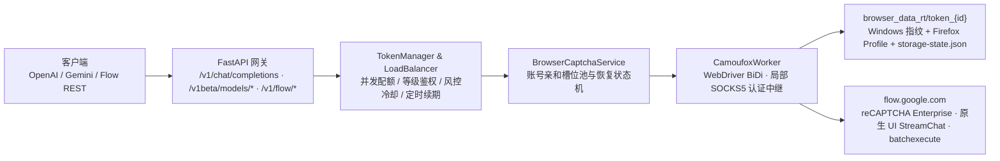

# Flow2API

**基于 Camoufox + WebDriver BiDi 原生浏览器管线的 Google Flow OpenAI / Gemini / Flow 原生兼容网关**

Flow2API 通过隔离的 Camoufox（反检测 Firefox）浏览器会话与 WebDriver BiDi 协议直接驱动 `flow.google.com` 页面内原生交互与同源 RPC，将 Google Flow 的图像生成、视频生成（文生 / 图生 / 多图 / 续写 / 高清放大）、TTS 语音合成、持久化角色库、以及多轮 Creation Agent 统一封装为标准 OpenAI、Gemini 与 `/v1/flow/*` REST/SSE 接口。

---

## 核心能力

- **Camoufox + WebDriver BiDi 单会话执行管线**：移植自 `AIStudio2API` 的浏览器运行时（`src/services/camoufox_bidi.py`），为每个账号槽位锁定持久化 Windows 10/11 指纹（`camoufox-fingerprint.json`）、WebGL/字体子集与独立 Firefox Profile（`browser_data_rt/token_<id>/`）。打码、表单交互、`StreamChat` 生成与同源 `batchexecute` RPC 全部在同一浏览器上下文完成，消除独立打码端与发包端 TLS/Cookie 割裂导致的 `PUBLIC_ERROR_UNUSUAL_ACTIVITY`。
- **三协议 API 兼容**：
  - **OpenAI 兼容**：`GET /v1/models`、`GET /v1/models/aliases`、`POST /v1/chat/completions`（流式 SSE 进度 + 非流式）。
  - **Gemini 兼容**：`GET /v1beta/models`、`POST /v1beta/models/{model}:generateContent`、`:streamGenerateContent`（及 `/models/...` 路径），支持 `generationConfig.imageConfig` 动态分辨率与比例解析。
  - **Flow 原生特征接口 (`/v1/flow/*`)**：项目管理、资产上传/解析、TTS 语音生成与试听缓存（`json`/`wav`/`pcm`）、角色 CRUD、Creation Agent 多轮对话与费用确认（SSE / JSON）、用户与项目设置。
- **多账号调度、风控冷却与自动续期**：
  - `LoadBalancer` 支持随机负载优先与顺序轮询（`call_mode = "default" | "polling"`），按账号等级（Free / Pro / Ult）与图像/视频并发配额自动路由。
  - 遇到 `PUBLIC_ERROR_UNUSUAL_ACTIVITY` / `403` / `429` 时自动冷却槽位并切换下一可用账号；生成类 RPC 超时严格保护以防重复扣费；后台定时任务通过真实 Camoufox 实例续期 Google/Flow Cookies（`__Secure-1PSIDTS`、`SIDCC`、`OSID`）并原子写回 SQLite 与 `storage-state.json`。
- **LiveView 网页远程登录向导**：管理后台内置 WebSocket 实时画面流与键鼠转发，无需安装桌面环境或 Xvfb，在浏览器控制台即可完成 Google 账号登录并自动落盘完整凭证与指纹档案。
- **零外部 CDN 的重构控制台**：登录页（`/login`）、管理控制台（`/manage`）与工作台（`/test`）共用本地设计系统 `static/console.css`，支持浅色/深色主题切换、中英双语（`zh-CN` / `en`）、Camoufox 槽位池实时监控、Score 检测、日志过滤以及 Creation Agent / 语音与角色交互测试。

---

## 系统架构



---

## 快速开始

### 环境要求

- **Python**：3.10+（推荐 3.11–3.13）
- **浏览器运行时**：无需手动安装 Chrome 或 Playwright；首次启动服务或打开浏览器登录时，`src/services/camoufox_bidi.py` 会按宿主机架构（macOS `arm64`/`x86_64`、Linux `x86_64`/`arm64`、Windows `x86_64`）自动下载并解压 Camoufox 至 `.runtime/camoufox/`（或复用本地 `CAMOUFOX_PATH`）。

### 本地源码部署

```bash
# 1. 克隆仓库
git clone https://github.com/jianli9158/flow2api.git
cd flow2api

# 2. 创建虚拟环境并安装依赖
python3 -m venv .venv
source .venv/bin/activate  # Windows: .venv\Scripts\activate
pip install -r requirements.txt

# 3. 启动服务（首次启动会自动从 config/setting_example.toml 生成 config/setting.toml 与 data/flow.db）
python main.py
```

默认监听 `http://0.0.0.0:8000`（可在 `config/setting.toml` 中调整 `[server].port`）。

### Docker Compose 部署

仓库提供三种 Compose 编排文件以适配不同部署环境：

1. **标准无头部署（推荐，`docker-compose.yml`）**
   ```bash
   cp -n config/setting_example.toml config/setting.toml
   docker compose up -d --build
   ```
   容器内置 GTK3 / X11 / 音频共享库支持无头 Camoufox，持久化挂载 `./data`、`./tmp`、`./browser_data_rt` 与 `./config/setting.toml`，宿主机映射端口 **`38000:8000`**（访问 `http://localhost:38000`）。

2. **搭配 WARP 代理容器部署（`docker-compose.proxy.yml`）**
   ```bash
   cp -n config/setting_example.toml config/setting_warp.toml
   docker compose -f docker-compose.proxy.yml up -d --build
   ```
   同时拉起 `caomingjun/warp` 容器并在 `31080:1080` 暴露 SOCKS5 入口。

3. **Xvfb 有头环境部署（`docker-compose.headed.yml`）**
   ```bash
   docker compose -f docker-compose.headed.yml up -d --build
   ```
   使用 `Dockerfile.headed` 启动虚拟显示 `DISPLAY=:99`（`1440x900x24`），端口映射 **`8000:8000`**。

### 首次登录与账号接入

1. 访问控制台 `http://localhost:8000`（Docker 标准部署为 `http://localhost:38000`），使用默认管理员凭证 `admin` / `admin` 登录，随后在「系统配置 -> 安全配置」修改管理员密码与 API Key。
2. 在 **Token 管理** 点击 **「浏览器登录」**：
   - 可选择 `auto`（本地弹窗 + 网页 LiveView）、`window`（本地可见窗口）或 `liveview`（纯无头网页远程画面，适合服务器与 Docker）。
   - 登录 Google 账号并跳转至 `https://flow.google.com/projects` 后，系统自动保存 Cookie、Windows 指纹、StorageState 及初始项目 UUID。
   - 如需通过浏览器扩展同步或手动导入，可使用「新增」或「导入」提交 JSON Cookie 导出或 `Cookie` 请求头字符串，或使用「系统配置 -> 插件连接配置」对接 Token Updater。

---

## 模型目录与解析规则

服务在 `/v1/models` 与 `/v1beta/models` 公开 **102 个**标准模型（**45 个图像模型 + 57 个视频模型**），同时在内部维护 **550 个**兼容别名与上游 usage key 映射（定义于 `src/services/generation_handler.py` 与 `src/core/model_resolver.py`）。

### 1. 图像生成（45 个公开变体）

| 模型系列 | 公开前缀 | 简写别名（配合 `imageConfig`） | 上游引擎 | 比例与分辨率矩阵 |
|---|---|---|---|---|
| **Nano Banana 2.1** | `gemini-3.1-flash-image-*` | `gemini-3.1-flash-image`、`nano-banana-2.1`、`nano-banana-2` | `BELUGA` | 5 种比例 × 3 档清晰度（默认 1K / 2K / 4K）= 15 个 |
| **Nano Banana 2 Lite** | `gemini-3.1-flash-lite-image-*` | `gemini-3.1-flash-lite-image`、`nano-banana-2-lite` | `HARBOR_SEAL` | 5 种比例 × 3 档清晰度（默认 1K / 2K / 4K）= 15 个 |
| **Nano Banana Pro** | `gemini-3.0-pro-image-*` | `gemini-3.0-pro-image`、`nano-banana-pro` | `GEM_PIX_2` | 5 种比例 × 3 档清晰度（默认 1K / 2K / 4K）= 15 个 |

**支持的 5 种画面比例后缀**：`-landscape`（16:9）、`-portrait`（9:16）、`-square`（1:1）、`-four-three`（4:3）、`-three-four`（3:4），各自叠加可选后缀 `-2k` 或 `-4k`。所有图像模型支持传入 `0–5` 张参考图片进行图生图或风格参考。

### 2. 视频生成（57 个公开变体）

| 模型族 | 公开名称模式 | 能力说明 | 账号等级 |
|---|---|---|---|
| **Omni 1.2 Flash 默认别名** | `omni-1.2-flash`、`omni-1.2-flash-360p`、`omni-1.2-flash-{1080p,4k}` | 默认 8s 横屏，可选 0–3 张参考图（兼容 `omni` / `macaron` 别名） | Free / Pro / Ult |
| **Omni 1.2 Flash T2V / R2V** | `omni-1.2-flash-{4,6,8,10,15}s-{landscape,portrait}`（含 `-360p` / `-1080p` / `-4k`） | 文本或 0–3 张参考图生视频；别名支持完整 `3s–15s` 时长 | Free / Pro / Ult |
| **Omni 1.2 Flash I2V** | `omni-1.2-flash-i2v-{4,6,8,10,15}s-{landscape,portrait}`（含放大后缀） | 首帧 / 首尾帧视频（`11s–15s` 仅接受单首帧） | Free / Pro / Ult |
| **Omni 1.2 Flash Extend** | `omni-1.2-flash-extend-8s-{landscape,portrait}`（别名支持 `3s–10s`） | 基于 `extend://<mediaGenerationId>` 续写视频 | Pro / Ult |
| **Veo 3.1 Lite** | `veo-3.1-lite`、`veo-3.1-lite-{4,6,8}s-{landscape,portrait}`（及 `i2v` / `r2v` / `extend` / `1080p` / `4k`） | 轻量高速 Veo 3.1 模型族（R2V 最多 3 张图） | Free / Pro / Ult |

> 注：OpenAI `/v1/chat/completions` 请求可通过 `size`（如 `1024x1792`）、`quality`（`medium` -> `2k`，`high`/`hd`/`ultra` -> `4k`）自动解析；Gemini 接口可通过 `generationConfig.imageConfig.aspectRatio`（如 `"16:9"`、`"9:16"`、`"1:1"`、`"4:3"`、`"3:4"`）与 `imageSize`（`"1K"`/`"2K"`/`"4K"`/`"360p"`/`"1080p"`）自动路由。

---

## API 接口参考

所有业务接口均通过 `Authorization: Bearer <api_key>` 或 `x-goog-api-key: <api_key>` 鉴权（默认 `han1234`）。

### OpenAI 与 Gemini 生成接口

- **`POST /v1/chat/completions`**（支持 `stream: true` 实时推流进度）
  ```bash
  curl -X POST "http://localhost:8000/v1/chat/completions" \
    -H "Authorization: Bearer han1234" \
    -H "Content-Type: application/json" \
    -d '{
      "model": "gemini-3.1-flash-image-landscape",
      "messages": [{"role": "user", "content": "雨夜赛博朋克街道，霓虹水面倒影，电影胶片质感"}],
      "stream": true
    }'
  ```
- **图生图 / 图生视频**：在 `messages[].content` 传入 `{"type": "image_url", "image_url": {"url": "data:image/png;base64,..."}}` 或图片 URL。
- **视频续写**：传入 `{"type": "image_url", "image_url": {"url": "extend://<source_mediaGenerationId>"}}`。
- **`POST /v1beta/models/{model}:generateContent` / `:streamGenerateContent`**（同时挂载在 `/models/...`）：
  ```bash
  curl -X POST "http://localhost:8000/v1beta/models/gemini-3.1-flash-image:generateContent" \
    -H "x-goog-api-key: han1234" \
    -H "Content-Type: application/json" \
    -d '{
      "contents": [{"role": "user", "parts": [{"text": "棚拍极简玻璃茶壶，柔和自然光"}]}],
      "generationConfig": {"responseModalities": ["IMAGE"], "imageConfig": {"aspectRatio": "16:9", "imageSize": "2K"}}
    }'
  ```

### Flow 原生特征接口 (`/v1/flow/*`)

| 类别 | 方法与路径 | 说明 |
|---|---|---|
| **项目与资产** | `GET /v1/flow/projects/{project_id}` | 读取指定 Flow 项目详情与媒体/语音/角色资产列表 |
| | `GET /v1/flow/assets/{media_id}` | 解析资产签名下载地址与元数据 |
| | `POST /v1/flow/assets` | 上传参考图（JSON `image_base64`/`image_url` 或 multipart 文件）返回 `mediaId` |
| **语音与 TTS** | `GET /v1/flow/voices` / `GET /v1/flow/voices/{voice_ref}` | 列出内置音色与项目自定义语音 / 获取单个音色 |
| | `POST /v1/flow/voices` | TTS 合成；支持 `response_format` 为 `json`、`wav` 或 `pcm`，及 `cache_audio` |
| | `DELETE /v1/flow/voices/{voice_ref}` | 删除自定义语音 |
| **角色管理** | `GET /v1/flow/characters` / `GET /v1/flow/characters/{character_id}` | 列出或查询角色设定 |
| | `POST /v1/flow/characters` / `PATCH /v1/flow/characters/{character_id}` / `DELETE /v1/flow/characters/{character_id}` | 创建、更新（名称/音色/设定/收藏）或删除角色 |
| **Creation Agent** | `POST /v1/flow/agent/chat` | 发起或继续 Agent 对话（`stream: true` 输出 SSE：`session` / `thinking` / `text` / `a2ui` / `media` / `permission` / `done` / `error`） |
| | `POST /v1/flow/agent/sessions/{session_id}/approve` | 批准（`approved`）或拒绝（`denied`）Agent 扣费/生成确认卡片 |
| | `GET /v1/flow/agent/sessions` / `GET` / `PATCH` / `DELETE .../{session_id}` | 查询会话列表、读取历史轮次、重命名或删除会话 |
| **偏好与设置** | `GET` / `PATCH /v1/flow/user/preferences` | 读取或更新 Flow 用户全局偏好（自动清框、水印开关等） |
| | `GET` / `PATCH /v1/flow/projects/{project_id}/settings` | 读取或更新项目面板与默认生图/生视频配置 |

### 控制台与监控端点

- `GET /login`、`GET /manage`、`GET /test`：登录页、管理控制台、模型/Agent/语音工作台
- `GET /health`：返回服务状态及活跃 / 即将过期 / 已过期 / 禁用账号统计
- `GET /metrics`：Prometheus 监控指标输出
- `GET /api/captcha/browser-stats` & `POST /api/captcha/score-test`：Camoufox 槽位实时状态与站点 reCAPTCHA 分数实测
- `POST /api/tokens/browser-login/start` & `WS /api/tokens/browser-login/ws/{session_id}`：启动 LiveView 远程登录会话与帧流转发

---

## Worker 直连模式（Direct Mode）

除通过 HTTP 网关调用外，也可以在 Python 进程内直接实例化 `CamoufoxWorker` 调用页面内原生 `StreamChat` 生图或生视频流水线（适用于脚本批处理或调试原生 UI 响应）：

```python
import asyncio
from src.services.camoufox_bidi import CamoufoxWorker

async def main():
    worker = CamoufoxWorker(
        token_id=1,
        profile_dir="browser_data_rt/token_1",
    )
    try:
        image_res = await worker.generate_native_image(
            project_id="<flow_project_uuid>",
            prompt="晨雾中的雪山木屋，柔和金色日光",
            aspect_ratio="IMAGE_ASPECT_RATIO_LANDSCAPE",
            model_name="BELUGA",
            token_id=1,
        )
        print("Image media:", image_res)

        video_res = await worker.generate_native_video(
            project_id="<flow_project_uuid>",
            prompt="镜头缓慢推进木屋，炊烟升起",
            aspect_ratio="VIDEO_ASPECT_RATIO_LANDSCAPE",
            model_key="veo_3_1_t2v_fast_landscape",
            token_id=1,
        )
        print("Video media:", video_res)
    finally:
        await worker.close()

asyncio.run(main())
```

---

## 配置参考（`config/setting.toml`）

核心配置项均在 `config/setting_example.toml` 提供默认值，并可通过管理后台实时持久化到 SQLite（`data/flow.db`）：

| 配置节 | 关键字段 | 默认值 | 说明 |
|---|---|---|---|
| `[global]` | `api_key`、`admin_username`、`admin_password` | `"han1234"` / `"admin"` | API 密钥与后台管理员凭证 |
| `[server]` | `host`、`port` | `"0.0.0.0"` / `8000` | 服务监听地址（支持环境变量 `FLOW2API_SERVER_PORT` 覆盖） |
| `[captcha]` | `captcha_method`、`browser_engine` | `"camoufox"` | 浏览器引擎；`browser_in_page_rpc = true` 开启页面内 XHR/StreamChat |
| `[captcha]` | `browser_count`、`browser_personal_fresh_restart_every_n_solves` | `1` / `10` | 常驻 Camoufox 槽位数量与每 N 次成功求解后轮换重启阈值（`0` 为禁用） |
| `[captcha]` | `browser_flow_page_warmup_seconds`、`personal_project_pool_size` | `6.0` / `4` | Flow 页面预热等待时间与单账号默认项目池大小 |
| `[generation]` | `image_timeout`、`video_timeout` | `300` / `1500` | 图像与视频生成超时上限（秒） |
| `[call_logic]` | `call_mode` | `"default"` | `"default"`（负载均衡）或 `"polling"`（稳定顺序轮询） |
| `[cache]` | `enabled`、`timeout`、`base_url` | `false` / `7200` / `""` | 本地媒体文件缓存、过期清理时间（`0` 永不过期）与外链访问域名 |
| `[proxy]` | `proxy_enabled`、`proxy_url` | `false` / `""` | 协议回退与下载代理（支持 `http://` 与 `socks5://`） |

---

## 许可证

本项目基于 [MIT 许可证](LICENSE) 开源。
